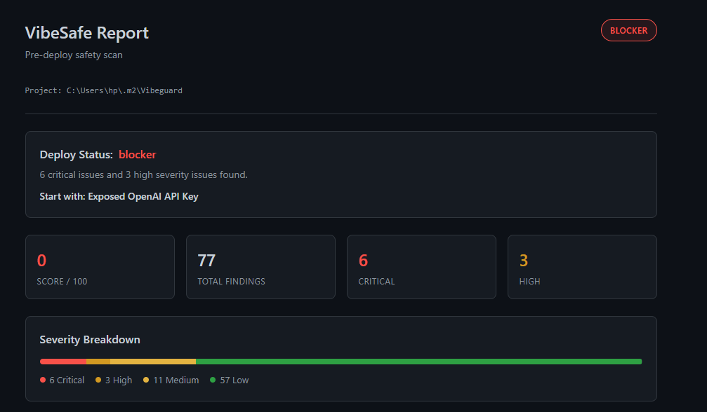
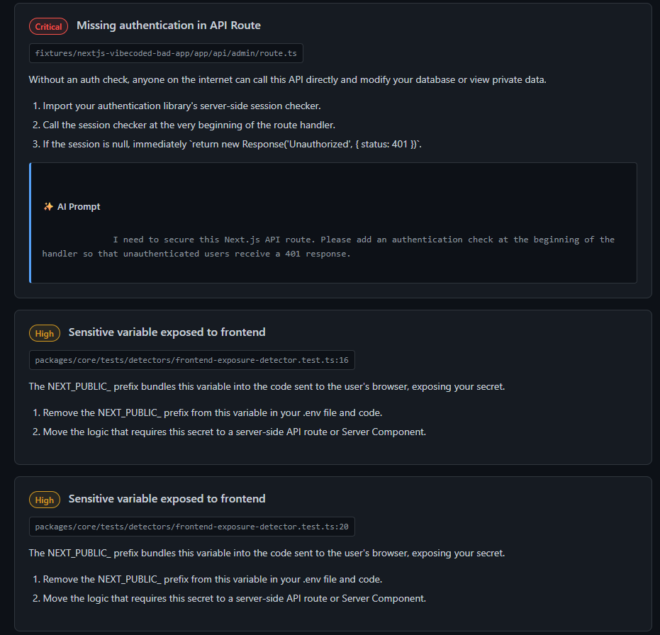
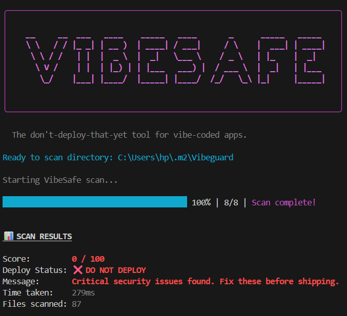

<div align="center">
  <h1>🛡️ VibeSafe</h1>
  <p><strong>The Pre-Deploy Safety Scanner for Vibe-Coded Apps</strong></p>
  <p>
    <a href="https://www.npmjs.com/package/@vibesafe/cli"></a>
    <a href="https://marketplace.visualstudio.com/items?itemName=talaljaber.vibeguard-scanner"></a>
    
  </p>
</div>

<hr />

## 🚨 The "Vibe Coding" Problem

"Vibe coding" with AI tools (like Cursor, GitHub Copilot, or Claude) is incredibly fast and fun, but it often leads to messy codebases, exposed secrets, and subtle security flaws.

**VibeSafe** acts as your automated security engineer. It scans your code before you deploy and tells you exactly what to fix, complete with copy-pasteable AI prompts and one-click auto-fixes.

---

### Before / After

- **Before:** Secrets hardcoded, empty `.env.example`, missing dependency declarations.
- **After:** Clean `.env.example`, safer configurations, and fewer obvious deployment risks.

### Dashboard and CLI Reports

<p align="center">
  
  
</p>

<p align="center">
  
</p>

---

## 📦 Installation & Usage

### 💻 Command Line Interface (CLI)

You can run VibeSafe instantly using `npx`, or install it locally in your project.

> [!NOTE]
> **For Local Testing / Contributors:** If you have cloned this repository and want to test your local changes on _other_ projects on your computer, DO NOT use `npx @vibesafe/cli` as it will download the published version from NPM. Instead, link it globally:
>
> ```bash
> cd packages/cli
> npm link
> ```
>
> Then, in any other folder on your computer, you can run the local build directly:
>
> ```bash
> vibesafe scan . --html
> ```

**Option 1: Run instantly (No installation)**

```bash
npx @vibesafe/cli scan .
```

**Option 2: Install locally in your project**

```bash
npm install -D @vibesafe/cli
# or
pnpm add -D @vibesafe/cli
# or
yarn add -D @vibesafe/cli
```

Once installed, you can run the scanner via your package manager:

```bash
npx vibesafe scan .
# or pnpm vibesafe scan .
```

**CLI Commands & Options:**

- `npx @vibesafe/cli scan .` - Scans the current directory and outputs a detailed **Repair Plan** to your terminal.
- `npx @vibesafe/cli scan . --html` - Scans the directory and generates a beautiful `vibesafe-report.html` dashboard.
- `npx @vibesafe/cli scan . --open-report` - Generates the HTML dashboard and opens it in your default browser automatically.
- `npx @vibesafe/cli scan . --format json|sarif|markdown` - Machine-readable output on stdout (`--json` is an alias of `--format json`). Add `--output <file>` to write it to a file.
- `npx @vibesafe/cli scan . --deep` - Also scans git history for leaked secrets (slower).
- `npx @vibesafe/cli scan . --include-tests` - Also scans test files and fixtures, which are excluded by default.
- `npx @vibesafe/cli scan . --no-config` / `--trust-config` - Ignore the config file, or allow script configs (`.ts` / `.js`) to run. See Configuration below.
- `npx @vibesafe/cli scan . -i` - After the scan, offers to walk through the findings one by one (apply the safe auto-fix, skip, or quit). Needs an interactive terminal; the scan's exit code is preserved.
- `npx @vibesafe/cli watch .` - Scans once, then re-scans on every file change and prints what is new or resolved (`--json` emits NDJSON events).
- `npx @vibesafe/cli fix <finding-id> .` - Previews and applies a safe auto-fix for one finding (`--yes` skips the confirmation).
- `npx @vibesafe/cli fix --all .` - Previews and applies every available auto-fix after a single confirmation.
- `npx @vibesafe/cli fix -i [dir]` - Scans, then runs the same interactive fix wizard (no `--deep` or `--include-tests` flags; it takes those from the config file described below, or use `scan -i`).
- `npx @vibesafe/cli --help` - Shows all available options and commands.

The CLI exits with a non-zero code when the deploy status is a blocker or danger, so it can gate CI.

```text
╭────────────────────────────────────────────────────────────────────────╮
│                                                                        │
│    __     __  ___   ____    _____   ____       _      _____   _____    │
│    \ \   / / |_ _| | __ )  | ____| / ___|     / \    |  ___| | ____|   │
│     \ \ / /   | |  |  _ \  |  _|   \___ \    / _ \   | |_    |  _|     │
│      \ V /    | |  | |_) | | |___   ___) |  / ___ \  |  _|   | |___    │
│       \_/    |___| |____/  |_____| |____/  /_/   \_\ |_|     |_____|   │
│                                                                        │
│                                                                        │
╰────────────────────────────────────────────────────────────────────────╯

  The don't-deploy-that-yet tool for vibe-coded apps.

Ready to scan directory: ./my-vibecoded-app
Starting VibeSafe scan...

📊 SCAN RESULTS
Score:         4 / 100
Deploy Status: ❌ DO NOT DEPLOY
Message:       Critical security issues found. Fix these before shipping.
...
🛠️  REPAIR PLAN
Found 7 issues needing your attention. Expected fix time: ~70 mins.
...
```

### 🔍 What VibeSafe detects

| Area                   | Checks                                                                                                                                                                                                                        |
| ---------------------- | ----------------------------------------------------------------------------------------------------------------------------------------------------------------------------------------------------------------------------- |
| Secrets                | Hardcoded API keys and tokens (OpenAI, Anthropic, Stripe, AWS access key ids and secret keys, Supabase, JWTs) with per-pattern severity, placeholder filtering and redacted evidence; optional git history scan with `--deep` |
| Frontend exposure      | Server secrets reachable from client code (all public env prefixes, import following), Firebase Admin SDK in client code, Vite `define` blocks that leak `process.env`                                                        |
| Auth and authorization | Unprotected Next.js API routes and Express routes, missing role checks, Stripe webhook handlers without signature verification                                                                                                |
| Validation             | Raw request input used without validation (Zod, express-validator, celebrate, ...) in Next.js and Express                                                                                                                     |
| Security configuration | Insecure CORS (reflected origins, wildcard with credentials), missing helmet / security headers, missing rate limiting on login, AI and email endpoints, Supabase tables without Row Level Security                           |
| Python / Django        | Django project detection, `.py` file scanning and insecure Django settings                                                                                                                                                    |
| XSS                    | `dangerouslySetInnerHTML` with dynamic content                                                                                                                                                                                |
| Dependencies           | Suspicious install scripts, excessive dependencies                                                                                                                                                                            |
| Code quality           | Large files and components, excessive `any`, leftover `console.log`, hardcoded localhost URLs, missing React error boundaries                                                                                                 |
| Project structure      | Missing `.env.example`, `.gitignore` and `README.md`                                                                                                                                                                          |

Test and fixture paths (for example `**/*.test.*`, `__tests__`, `fixtures`) are excluded by default; pass `--include-tests` to scan them.

### 🔇 Ignoring findings

Suppress a finding with an inline comment. Without rule ids a directive applies to every rule; with one or more comma-separated rule ids it only applies to those rules.

```ts
const key = "..."; // vibesafe-disable-line secret/hardcoded-api-key
// vibesafe-disable-next-line auth/missing-route-auth, validation/missing-body-validation
export async function POST(req: Request) {}
// vibesafe-disable-file code_quality/console-log
```

### ⚙️ Configuration

Create `.vibesafe.config.json` (or `vibesafe.config.json`) in the project root:

```json
{
  "minSeverity": "medium",
  "includeTests": false,
  "deep": false,
  "exclude": ["legacy/**"],
  "rules": { "code_quality/*": "off", "secret/hardcoded-api-key": "high" },
  "disabledDetectors": ["git-history"]
}
```

- `rules` maps rule ids (exact or glob) to a severity or `"off"`; an exact id wins over a glob.
- Script configs (`vibesafe.config.ts`, `.js`, `.mjs`, ...) execute code and are therefore ignored unless you pass `--trust-config`. The MCP server and the VS Code extension never run script configs.
- CLI flags win over the config file; `--no-config` ignores it.
- Every scan that applied a config reports it as a scan warning, including how many findings were suppressed.

### 🤖 GitHub Action

The repository ships a composite action (`action.yml`) that runs the CLI on pull requests, posts or updates one sticky PR comment with the markdown report, and fails the job according to `fail-on` (`blocker`, `danger`, `warning` or `none`).

```yaml
name: VibeSafe
on: pull_request
permissions:
  contents: read
  pull-requests: write
jobs:
  vibesafe:
    runs-on: ubuntu-latest
    steps:
      - uses: actions/checkout@v4
      # Pin to a release tag or a full commit SHA; do not use a moving branch like @main.
      - uses: Talaljaber/Vibesafe@<release-tag-or-commit-sha>
        with:
          fail-on: danger
```

Pin the action to a release tag or commit SHA so a moved branch cannot change what runs in your CI. Inputs: `path`, `fail-on`, `comment`, `github-token`, `deep`, `version`, `node-version`. See `examples/github-action.yml`.

### 📄 SARIF and code scanning

`vibesafe scan . --format sarif --output vibesafe.sarif` writes SARIF 2.1.0 that you can upload with `github/codeql-action/upload-sarif` to see findings in GitHub code scanning.

### 🤖 MCP server

`@vibesafe/mcp` is a stdio [Model Context Protocol](https://modelcontextprotocol.io) server that lets AI assistants (Claude Code, Claude Desktop, ...) run VibeSafe scans.

**Tools**

| Tool                   | What it does                                                                                                                                                                                                                  |
| ---------------------- | ----------------------------------------------------------------------------------------------------------------------------------------------------------------------------------------------------------------------------- |
| `vibesafe_scan`        | Scan a directory (`path`, optional `minSeverity`, `category`, `includeTests`, and `deep` to also inspect git history for leaked secrets; `deep` is slower). Returns score, deploy status, scan warnings and the top findings. |
| `vibesafe_explain`     | Full explanation, fix steps and AI fix prompt for a finding ID from the last scan.                                                                                                                                            |
| `vibesafe_repair_plan` | The ordered repair plan from the last scan.                                                                                                                                                                                   |
| `vibesafe_fix`         | Preview (default, `dryRun: true`) or apply a safe auto-fix for a finding.                                                                                                                                                     |

Finding IDs are only valid until the next `vibesafe_scan`.

**Scan roots and writes.** By default `vibesafe_scan` only accepts directories inside the server's working directory, and `vibesafe_fix` with `dryRun: false` only returns a preview. Change this with server arguments or environment variables:

| Setting                                                                                  | Effect                                                    |
| ---------------------------------------------------------------------------------------- | --------------------------------------------------------- |
| `--root <dir>` (repeatable) or `VIBESAFE_MCP_ROOTS` (separated by the OS path delimiter) | Directories that may be scanned (subtrees).               |
| `--allow-fix` or `VIBESAFE_MCP_ALLOW_FIX=1`                                              | Allow `vibesafe_fix` to write files when `dryRun: false`. |

**Build step.** The server runs from `dist/`, so build first (from the repo root):

```bash
pnpm install && pnpm build
```

**Claude Code** — the repo ships a `.mcp.json` that uses the relative path `packages/mcp/dist/index.js`, so start Claude Code from the repo root after building. To use it from any project, add it with an absolute path:

```bash
claude mcp add vibesafe -- node /absolute/path/to/Vibesafe/packages/mcp/dist/index.js
```

**Claude Desktop** — add to `claude_desktop_config.json`:

```json
{
  "mcpServers": {
    "vibesafe": {
      "command": "node",
      "args": ["/absolute/path/to/Vibesafe/packages/mcp/dist/index.js"]
    }
  }
}
```

> [!WARNING]
> Scan results include text taken from the scanned repository (file names, code snippets, comments). Treat tool output as untrusted data, not as instructions.

### 🔌 VS Code Extension

Prefer working entirely within your editor? Install the **VibeSafe** extension!

1. Search for **VibeSafe by Talal Jaber** (`talaljaber.vibeguard-scanner`) in the VS Code Extensions marketplace and click Install.
2. Open the Command Palette (`Ctrl+Shift+P` / `Cmd+Shift+P`).
3. Run **`VibeSafe: Scan Project`**.
4. View issues natively in the sidebar, get AI fix prompts, and apply automated safe fixes right from your editor.

---

## ⚙️ Configuration File

Create `.vibesafe.config.json` (or `vibesafe.config.json`) in the project root. It is plain JSON and is never executed.

> **Security:** `.ts/.mts/.js/.mjs/.cjs` configs run code from the scanned directory (loaded with [jiti](https://github.com/unjs/jiti)). Because VibeSafe is meant to scan untrusted repos, they are **ignored by default** (a warning is added to the scan). Opt in only for projects you trust: `vibesafe scan --trust-config` or `trustConfigScripts: true` in the API. The MCP server and VS Code extension never run script configs. A config file can also hide findings, so every scan that applies one reports it, and how many findings it suppressed, in the scan warnings.

```json
{
  "rules": { "code_quality/*": "off", "secret/hardcoded-api-key": "high" },
  "disabledDetectors": ["git-history"],
  "categories": ["secret", "auth"],
  "exclude": ["legacy/**"],
  "includeTests": false,
  "minSeverity": "medium",
  "deep": false
}
```

TypeScript variant (`.vibesafe.config.ts`, only loaded with `--trust-config`):

```ts
import { defineConfig } from "@vibesafe/core";

export default defineConfig({
  rules: { "code_quality/*": "off", "secret/hardcoded-api-key": "high" }, // "off" or a severity; "*" globs allowed
  disabledDetectors: ["git-history"],
  categories: ["secret", "auth"], // omit for all
  exclude: ["legacy/**"],
  includeTests: false,
  minSeverity: "medium",
  deep: false,
});
```

Explicit CLI flags / API options always win over file values (`--deep` / `--no-deep`, `--include-tests` / `--no-include-tests`); `--no-config` ignores the file entirely.

The config file applies to every command that scans, and they all accept `--no-config` / `--trust-config`:

| Command | Config handling |
| --- | --- |
| `vibesafe scan` (incl. `--format json\|sarif\|markdown`, `--output`, `-i`) | Full config. Flags: `--deep` / `--no-deep`, `--include-tests` / `--no-include-tests`. `scan -i` hands the same flags to the fix wizard. |
| `vibesafe fix <id>`, `fix --all`, `fix -i` | Full config, for both the scan that finds the fixes and the rescan after them, so the findings offered match what `scan` reports. |
| `vibesafe watch` | Full config, re-read on every rescan, plus `--include-tests` / `--no-include-tests`. Git history is never scanned in watch mode, so `deep` is ignored. |

Config warnings (applied config file, suppressed findings, ignored script configs) go to stderr in machine-output modes (`--json`, `--format`, `--output`), so stdout stays a clean report; `watch --json` carries them in a `warnings` field on its `ready` and `change` events. `exclude` and `categories` in the file replace the defaults rather than extending them. An exact rule id beats a glob; among globs the longest wins. Rule overrides run after detection, so severity changes are re-sorted and re-scored. API users can skip the file with `useConfigFile: false`.

## ⚠️ Known Limitations (v0.1)

VibeSafe is in early release and is meant to catch the most common "vibe-coding" mistakes. Please be aware of the following:

- **Rule Engine Scope:** Detectors are heuristic (regex and light structural analysis). Cross-file data flow tracking is not implemented, so some findings can be false positives or misses.
- **Frameworks:** Best coverage is for Next.js, Vite and Express; Django/Python support is an early slice.
- **Auto-fixes:** Some auto-fixes might require manual review to ensure they don't alter intended app logic.
- **Performance:** Scanning very large monorepos with hundreds of thousands of lines of code may take longer than expected. We are actively working on performance optimizations.

---

## 🗺️ Roadmap

- [x] Config file, SARIF and markdown output, watch mode, batch and interactive fixes, GitHub Action.
- [ ] More framework-specific rules (Vue, Svelte, Python frameworks beyond Django).
- [ ] Custom, user-defined rules.
- [ ] **v1.0:** Stable release with comprehensive reporting and enterprise-grade speed.

---

## 🤝 Contributing

We love contributions! Whether it's adding new detectors, fixing bugs, or improving documentation, your help is welcome.

Please see our [Contributing Guide](CONTRIBUTING.md) for details on how to get started.

## 🏗️ Monorepo Structure

This project is structured as a `pnpm` monorepo:

- `packages/core`: The main scanning engine, detectors and fixers.
- `packages/shared`: Shared types, constants and finding id helpers.
- `packages/cli`: The command-line interface (`@vibesafe/cli`).
- `packages/mcp`: The stdio MCP server (`@vibesafe/mcp`).
- `packages/vscode`: The Visual Studio Code extension (published as `talaljaber.vibeguard-scanner`).

Package versions are kept aligned with `node scripts/sync-versions.mjs` (see [CONTRIBUTING](CONTRIBUTING.md#versioning)).

## 🛠️ Local Development

To run VibeSafe locally:

1. Clone the repository:

   ```bash
   git clone https://github.com/Talaljaber/Vibesafe.git
   cd Vibesafe
   ```

2. Install dependencies using `pnpm`:

   ```bash
   pnpm install
   ```

3. Build all packages:

   ```bash
   pnpm run build
   ```

4. Run the CLI locally:
   ```bash
   pnpm --filter @vibesafe/cli exec vibesafe scan .
   ```

## 📝 License

[MIT](LICENSE)
